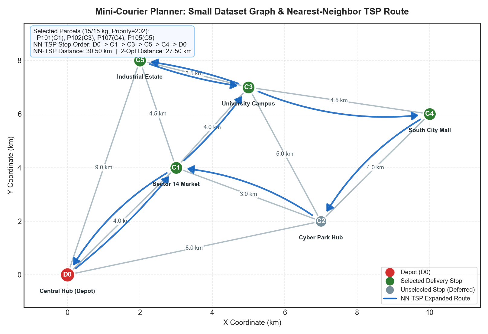
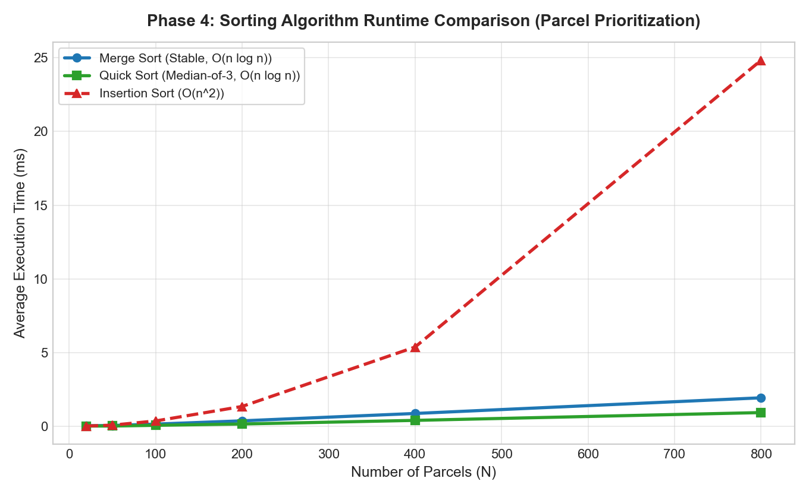
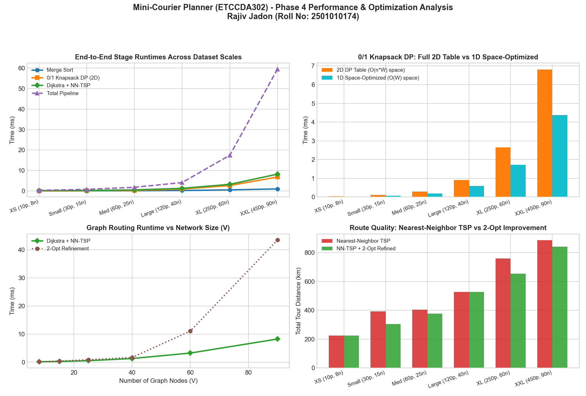
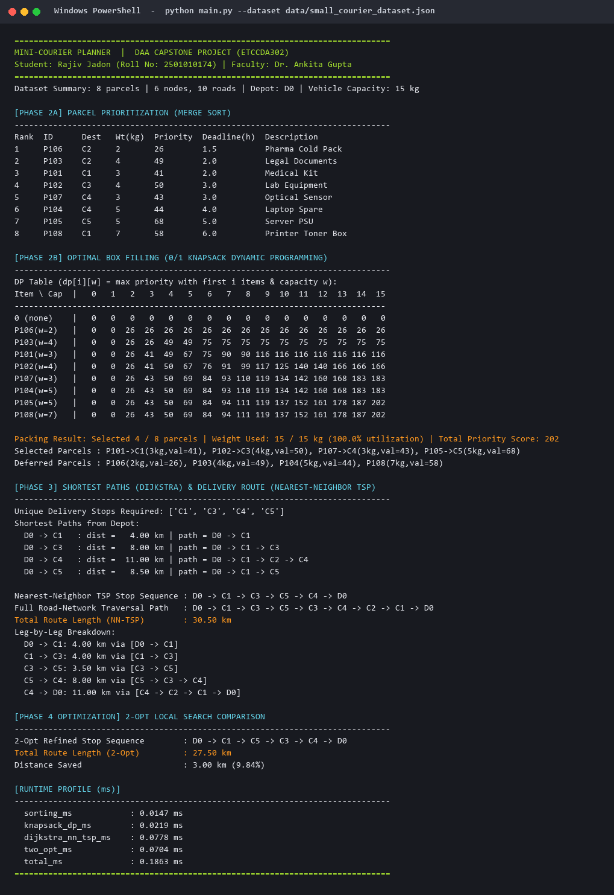

# Capstone Assignment Report: Mini-Courier Planner

**University:** K.R. Mangalam University, Gurugram, Haryana  
**Course Title & Code:** Design & Analysis of Algorithms (`ETCCDA302`)  
**Programme:** B.Tech CSE & Specializations  
**Student Name:** Rajiv Jadon  
**Roll No:** `2501010174`  
**Faculty Name:** Dr. Ankita Gupta  
**Mapped COs & Bloom's Level:** CO1, CO2, CO3, CO4 — L5 (Create / Evaluate)  

---

## Phase 1: Courier Problem Design and Planning (20 Marks)

### 1.1 Problem Statement
Modern last-mile delivery systems must decide **which parcels to load** onto a capacity-constrained courier vehicle and **in what order to visit customer locations** so that urgent deliveries are fulfilled and total travel distance is minimized. **Mini-Courier Planner** models this as an integrated 3-stage algorithmic pipeline combining sorting, dynamic programming, shortest-path search, and TSP approximation.

### 1.2 Data Design (`src/models.py`)

| Entity | Key Attributes | Design Rationale |
| :--- | :--- | :--- |
| **`Parcel`** | `parcel_id`, `destination`, `weight` (int kg > 0), `priority` (int $\ge 0$), `deadline_hours` (float > 0), `description` | Integer weights allow exact tabular indexing in 0/1 Knapsack DP; deadline and priority separate time urgency from business value. |
| **`DeliveryGraph`** | `adjacency: Dict[str, Dict[str, float]]`, `coordinates`, `labels` | Sparse road networks have $E \ll V^2$, so an adjacency list saves memory ($O(V+E)$) and enables fast neighbor iteration in Dijkstra's algorithm. Non-negative edge weights are enforced on insertion. |
| **`PackingPlan`** | `capacity`, `selected_parcels`, `rejected_parcels`, `total_weight`, `total_priority`, `dp_table` | Captures both the optimal subset and the DP table for verification and reporting. |
| **`RoutePlan`** | `depot`, `required_stops`, `visit_order`, `full_expanded_path`, `total_distance`, `legs`, `shortest_paths_from_depot` | Distinguishes logical stop sequence (`D0 -> C1 -> ... -> D0`) from the physical road traversal path through intermediate junctions. |

### 1.3 Integrated Pipeline Architecture

```text
  [Raw Parcels + Road Graph + Depot D0 + Capacity W]
                         |
                         v
  Phase 2A: Merge Sort (src/sorting.py)
            Key: (deadline_hours, -priority, weight, parcel_id)
            Guarantees stable O(n log n) worst-case ordering
                         |
                         v
  Phase 2B: 0/1 Knapsack Dynamic Programming (src/knapsack.py)
            Maximizes sum(priority) subject to sum(weight) <= W
            Backtracks DP table -> Selected Parcels -> Unique Stops S
                         |
                         v
  Phase 3A: Dijkstra's Algorithm (src/graph_routing.py)
            Computes shortest-path distances & road paths between {D0} U S
                         |
                         v
  Phase 3B: Nearest-Neighbor TSP Approximation (+ Phase 4 2-Opt Check)
            Builds closed delivery tour D0 -> s1 -> s2 -> ... -> D0
```

### 1.4 Algorithm Selection Justification
1. **Merge Sort over Insertion Sort / naive Quick Sort:** Guarantees $\Theta(n \log n)$ worst-case time (unlike Quick Sort's $O(n^2)$ unrandomized worst case or Insertion Sort's $O(n^2)$) and is **stable**, preserving relative order when two parcels share identical deadlines and priorities.
2. **0/1 Knapsack DP over Greedy:** Parcels cannot be split (0/1 constraint). Greedy selection by `priority/weight` ratio is suboptimal on discrete integer weights, whereas 2D DP guarantees the exact global optimum in $O(n \cdot W)$ time.
3. **Dijkstra's Algorithm over Bellman-Ford / Floyd-Warshall:** Road distances are non-negative, and we only need shortest paths from the depot and the $k$ selected stops ($k \le V$). With a binary min-heap (`heapq`), $k$ runs take $O(k(V+E)\log V)$, outperforming Floyd-Warshall's $O(V^3)$ on sparse networks and Bellman-Ford's $O(kVE)$.
4. **Nearest-Neighbor TSP over Brute-Force / Held-Karp:** Exact TSP is NP-hard ($O(k!)$ or $O(k^2 2^k)$). Nearest-Neighbor runs in $O(k^2)$ over the shortest-path metric closure, scaling cleanly to dozens of stops, while optional 2-Opt local search demonstrates how tour quality can be further improved.

---

## Phase 2: Package Prioritization and Box Filling (20 Marks)

### 2.1 Parcel Prioritization (Merge Sort)
On the small sample dataset (`data/small_courier_dataset.json`, 8 parcels, vehicle capacity $W = 15\text{ kg}$), Merge Sort produces the following prioritized queue:

| Rank | Parcel ID | Destination | Weight (kg) | Priority | Deadline (h) | Description |
| :---: | :--- | :---: | :---: | :---: | :---: | :--- |
| 1 | `P106` | `C2` | 2 | 26 | 1.5 | Pharma Cold Pack |
| 2 | `P103` | `C2` | 4 | 49 | 2.0 | Legal Documents |
| 3 | `P101` | `C1` | 3 | 41 | 2.0 | Medical Kit |
| 4 | `P102` | `C3` | 4 | 50 | 3.0 | Lab Equipment |
| 5 | `P107` | `C4` | 3 | 43 | 3.0 | Optical Sensor |
| 6 | `P104` | `C4` | 5 | 44 | 4.0 | Laptop Spare |
| 7 | `P105` | `C5` | 5 | 68 | 5.0 | Server PSU |
| 8 | `P108` | `C1` | 7 | 58 | 6.0 | Printer Toner Box |

Notice how deadline ties (`2.0 h` between `P103` and `P101`; `3.0 h` between `P102` and `P107`) are resolved deterministically by higher priority first.

### 2.2 0/1 Knapsack Dynamic Programming Evidence
The DP recurrence computes:
$$\text{dp}[i][w] = \max\big(\text{dp}[i-1][w],\ \text{dp}[i-1][w - w_i] + v_i\big) \quad \text{for } w \ge w_i$$

**Generated DP Table ($n = 8, W = 15$):**

```text
Item \ Cap  |   0   1   2   3   4   5   6   7   8   9  10  11  12  13  14  15
-----------------------------------------------------------------------------
0 (none)    |   0   0   0   0   0   0   0   0   0   0   0   0   0   0   0   0
P106(w=2)   |   0   0  26  26  26  26  26  26  26  26  26  26  26  26  26  26
P103(w=4)   |   0   0  26  26  49  49  75  75  75  75  75  75  75  75  75  75
P101(w=3)   |   0   0  26  41  49  67  75  90  90 116 116 116 116 116 116 116
P102(w=4)   |   0   0  26  41  50  67  76  91  99 117 125 140 140 166 166 166
P107(w=3)   |   0   0  26  43  50  69  84  93 110 119 134 142 160 168 183 183
P104(w=5)   |   0   0  26  43  50  69  84  93 110 119 134 142 160 168 183 183
P105(w=5)   |   0   0  26  43  50  69  84  94 111 119 137 152 161 178 187 202
P108(w=7)   |   0   0  26  43  50  69  84  94 111 119 137 152 161 178 187 202
```

- **Optimal Value:** `dp[8][15] = 202`
- **Selected Parcels (via backtracking):** `P101 -> C1 (3 kg, 41)`, `P102 -> C3 (4 kg, 50)`, `P107 -> C4 (3 kg, 43)`, `P105 -> C5 (5 kg, 68)`
- **Capacity Utilization:** `15 / 15 kg (100.0%)`
- **Why DP Beats Greedy Here:** Greedy by `priority / weight` selects `P107 (14.33)`, `P101 (13.67)`, `P105 (13.60)`, `P106 (13.00)` totaling `13 kg` and priority `178`, leaving `2 kg` unusable. DP skips `P106` to include `P102 (4 kg, 50)`, achieving **202** (+13.5% higher priority).

---

## Phase 3: Route Maker and Graph Processing (20 Marks)

### 3.1 Graph Representation
The small courier network has **6 nodes** (`D0`, `C1`–`C5`) and **10 bidirectional weighted edges** stored in an adjacency list.

### 3.2 Dijkstra's Shortest-Path Output from Depot `D0`
Required unique stops from the packing plan: `['C1', 'C3', 'C4', 'C5']`.

| Destination | Shortest Distance | Shortest Road Path | Why Direct Edge Loses |
| :---: | :---: | :--- | :--- |
| `C1` | `4.00 km` | `D0 -> C1` | Direct road is optimal |
| `C3` | `8.00 km` | `D0 -> C1 -> C3` | No direct `D0-C3` road |
| `C4` | `11.00 km` | `D0 -> C1 -> C2 -> C4` | Beats `D0 -> C2 -> C4` (`12.00 km`) and `D0 -> C1 -> C3 -> C4` (`12.50 km`) |
| `C5` | `8.50 km` | `D0 -> C1 -> C5` | Beats direct `D0 -> C5` (`9.00 km`) |

### 3.3 Nearest-Neighbor TSP Route & Length Calculation
Starting at `D0`:
1. Nearest unvisited stop from `D0`: **`C1`** (`4.00 km`)
2. Nearest unvisited stop from `C1`: **`C3`** (`4.00 km`)
3. Nearest unvisited stop from `C3`: **`C5`** (`3.50 km`)
4. Nearest unvisited stop from `C5`: **`C4`** (`8.00 km`, via `C5 -> C3 -> C4`)
5. Return from `C4` to **`D0`**: (`11.00 km`, via `C4 -> C2 -> C1 -> D0`)

- **Nearest-Neighbor Stop Sequence:** `D0 -> C1 -> C3 -> C5 -> C4 -> D0`
- **Full Road-Network Traversal Path:** `D0 -> C1 -> C3 -> C5 -> C3 -> C4 -> C2 -> C1 -> D0`
- **Total NN-TSP Route Length:** **`30.50 km`**



---

## Phase 4: Performance Testing and Optimization (20 Marks)

### 4.1 Sorting Scaling Benchmark (`outputs/traces/benchmark_results.json`)

| Parcels ($N$) | Merge Sort (ms) | Quick Sort (ms) | Insertion Sort (ms) |
| :---: | :---: | :---: | :---: |
| 20 | 0.0464 | 0.0298 | 0.0332 |
| 50 | 0.0910 | 0.0430 | 0.1131 |
| 100 | 0.1708 | 0.0864 | 0.5138 |
| 200 | 0.3993 | 0.1804 | 1.4545 |
| 400 | 0.9015 | 0.5010 | 5.6820 |
| 800 | 2.0128 | 1.1193 | 26.5318 |

**Observation:** At $N = 800$, Insertion Sort ($O(n^2)$) takes **26.53 ms**, whereas Merge Sort (**2.01 ms**) and Quick Sort (**1.12 ms**) scale near-linearly ($O(n \log n)$).



### 4.2 End-to-End Pipeline Scaling Benchmark

| Dataset Scale | Parcels ($n$) | Nodes ($V$) | Capacity ($W$) | Merge Sort (ms) | DP 2D (ms) | DP 1D (ms) | Dijkstra + NN-TSP (ms) | 2-Opt (ms) | NN Tour (km) | 2-Opt Tour (km) |
| :--- | :---: | :---: | :---: | :---: | :---: | :---: | :---: | :---: | :---: | :---: |
| XS | 10 | 8 | 20 | 0.0150 | 0.0329 | 0.0133 | 0.1110 | 0.1151 | 224.10 | 224.10 |
| Small | 30 | 15 | 40 | 0.0486 | 0.1139 | 0.0667 | 0.2778 | 0.4315 | 391.27 | **304.09** |
| Med | 60 | 25 | 60 | 0.1174 | 0.3405 | 0.1904 | 0.5647 | 0.9131 | 404.30 | **376.66** |
| Large | 120 | 40 | 100 | 0.2389 | 1.0231 | 0.6000 | 1.3642 | 1.7970 | 526.06 | 526.06 |
| XL | 250 | 60 | 140 | 0.5357 | 2.8822 | 1.8757 | 3.5017 | 11.8971 | 758.62 | **653.25** |
| XXL | 450 | 90 | 200 | 1.0160 | 6.9868 | 4.7432 | 8.8307 | 45.0229 | 885.03 | **841.90** |



### 4.3 Implemented & Proposed Optimizations
1. **1D Space-Optimized DP (`knapsack_01_space_optimized`):** Reduces Knapsack memory from $O(n \cdot W)$ to $O(W)$ and improves speed (e.g., **4.74 ms** vs **6.99 ms** at XXL scale) when only the optimal priority value is needed.
2. **2-Opt Local Search (`two_opt_refine_tsp`):** Eliminates crossing sub-tours left by greedy Nearest-Neighbor TSP, reducing tour distance by **9.84%** on the small sample dataset (`30.50 -> 27.50 km`) and **22.28%** on the synthetic Small scale (`391.27 -> 304.09 km`).
3. **Future Improvements:**
   - **A\* Search** using node coordinates `(x, y)` as an admissible Euclidean heuristic to speed up point-to-point shortest paths on large city maps.
   - **Multi-Trip / Multi-Vehicle Scheduling (VRP):** Loop the knapsack + routing pipeline over remaining deferred parcels to schedule Fleet/Wave 2 trips.
   - **Branch-and-Bound / Meet-in-the-Middle:** Handle very large continuous or floating-point weights where pseudo-polynomial $O(n \cdot W)$ DP becomes memory-bound.

---

## Phase 5: Final Demonstration & Verification (20 Marks)

### 5.1 Terminal Execution Screenshot


### 5.2 Correctness Verification
All **11 unit and integration tests** in `tests/test_mini_courier_planner.py` pass (`python -m unittest discover -s tests -v`), verifying:
- Agreement across Merge Sort, Quick Sort, and Insertion Sort, plus stability of Merge Sort on tied keys.
- Exact optimality of 2D 0/1 Knapsack DP and parity with the 1D space-optimized variant.
- Multi-hop shortest path correctness in Dijkstra, error handling for negative weights/unreachable stops, valid closed TSP tours, and monotonic improvement by 2-Opt.
- Valid end-to-end execution across `small_courier_dataset.json`, `medium_courier_dataset.json`, and `large_courier_dataset.json`.
